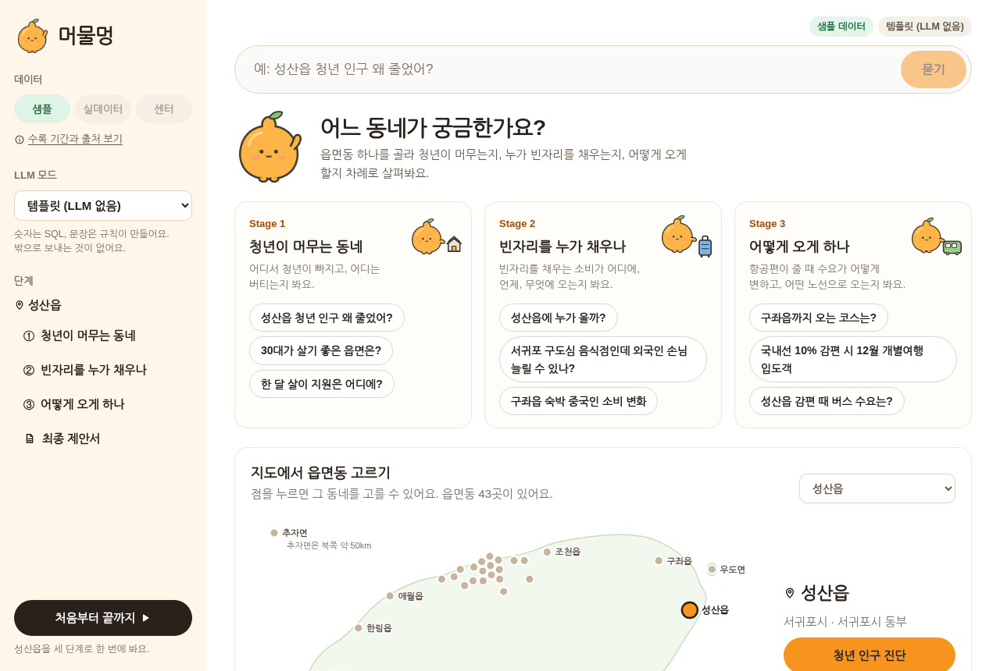
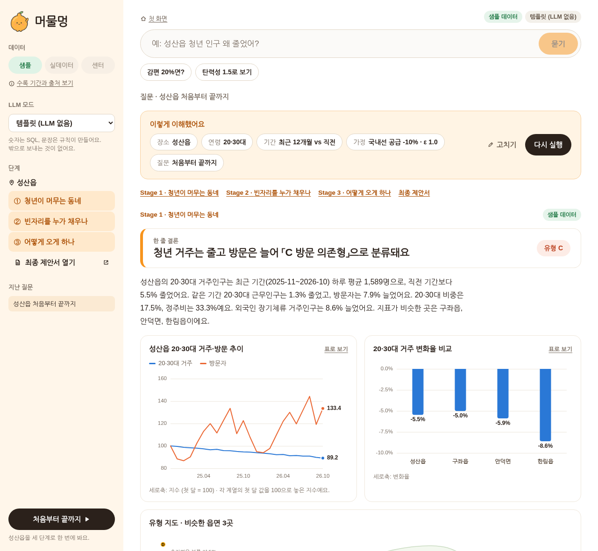
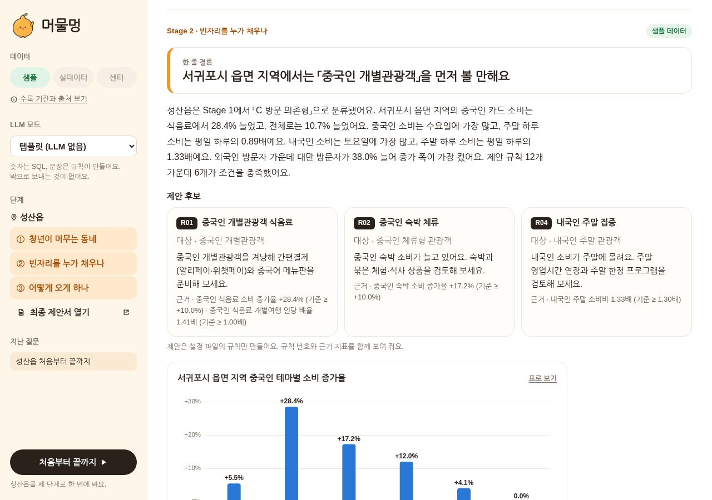

# 머물멍 (Jeju Town Vitality Agent)

제주 읍면동 하나를 골라 **청년이 머무는지 → 빈자리를 누가 채우는지 → 어떻게 오게 할지**를 차례로 진단하고,
근거표와 SQL이 붙은 최종 제안서까지 내는 AI 에이전트예요. 「제주 AI·빅데이터 활용 AI Agent 개발 챌린지」 출품작이에요.



---

## 무엇을 하나요

| 단계 | 답하는 질문 | 내놓는 것 |
|---|---|---|
| Stage 1 청년이 머무는 동네 | 어디서 청년이 빠지고, 어디는 버티는가 | 읍면동 활력 유형 A~D, 비슷한 읍면 3곳, 추천 순위 |
| Stage 2 빈자리를 누가 채우나 | 빈자리를 채우는 소비는 어디에, 언제, 무엇에 오는가 | 타깃 관광객, 테마·요일 분석, 규칙이 만든 제안 후보 |
| Stage 3 어떻게 오게 하나 | 항공편이 줄면 수요는 어떻게 변하고, 어떤 노선으로 오는가 | 수요 시나리오, 관광에 민감한 노선, 거점에서 오는 코스 |

세 단계는 이어져요. Stage 1의 유형이 Stage 2의 타깃을 정하고, Stage 2의 타깃이 Stage 3의 시나리오로 넘어가요.
"처음부터 끝까지"를 누르면 세 단계를 한 번에 돌리고 최종 제안서(HTML)를 만들어요.

**숫자는 SQL이, 제안 후보는 규칙이 만들어요. LLM은 질문 해석과 쉬운 해설만 맡고, 검증을 통과한 문장만 보여 줘요.**



---

## 바로 실행하기

### Docker 로 한 번에

```bash
docker compose up -d --build      # 처음에는 이미지를 만들어요 (2~3분)
```

브라우저에서 http://localhost:3000 을 열어요. 내릴 때는 `docker compose down` 이에요.
이미지에는 시드를 고정한 샘플 데이터가 들어 있어서 다른 준비 없이 바로 써 볼 수 있어요.

### 직접 실행

Python 3.11 과 Node 20.19 이상이 필요해요.

```bash
# 1) 백엔드 준비와 샘플 데이터 만들기
cd backend
uv venv --python 3.11 .venv
uv pip install --python .venv/bin/python -r requirements-dev.txt -e .
.venv/bin/python -m meomulmeong build-data

# 2) 화면 빌드
cd ../frontend && npm install && npm run build

# 3) 띄우기 (http://127.0.0.1:8501)
cd ../backend && .venv/bin/python -m meomulmeong serve --open
```

명령줄에서도 쓸 수 있어요.

```bash
.venv/bin/python -m meomulmeong ask "성산읍 청년 인구 왜 줄었어?"
.venv/bin/python -m meomulmeong chain 성산읍 --report
```

---

## 화면에서 할 수 있는 것

- **타이핑 없이 시작** — 단계별 추천 질문과 읍면동 지도에서 고르기
- **확인 카드** — "이렇게 이해했어요"로 장소·연령·기간·가정값을 실행 전에 보여 주고, 고쳐서 다시 실행
- **결론부터** — 한 줄 결론 → 쉬운 해설 → 차트·지도 → 근거표 → 한계. SQL은 접어 둬요
- **진행 표시** — 답을 만드는 동안 어떤 도구를 돌리고 있는지 한 줄씩 보여 줘요
- **다음 질문** — 답마다 이어서 물을 질문 3개. 그중 하나는 다음 단계로 가요
- **최종 제안서** — 세 단계 결과와 근거표, SQL, 한계를 한 문서로 묶어 열거나 내려받아요



---

## 믿을 수 있게 하는 장치

| 장치 | 막는 문제 |
|---|---|
| 숫자 대조 | 해설 속 숫자가 근거표와 다른 경우 |
| 숫자-지표 짝 · 초안 충실도 | 맞는 숫자를 다른 지표나 다른 대상에 붙이는 경우, 배율의 방향을 뒤바꾸는 경우 |
| 인과 표현 가드 | "관광객 때문에 청년이 떠났다"처럼 원인을 단정하는 문장 |
| 예측·추측 가드 | 가정을 밝히지 않은 예측 |
| 참조 대조 | 참조표에 없는 노선·읍면동 |
| 제안 근거 | 규칙 번호와 근거 지표가 없는 제안 |
| 가정치 표시 | 시나리오를 예측으로 읽는 일 (가정 배지, 탄력성 0.5 / 1.0 / 1.5 민감도) |
| 작은 표본 · 기간 확인 | 인구가 적은 곳의 변화율 과장, 기간이 다른 데이터 섞기 |
| 반출 게이트 | 원자료·소집단 노출 |

LLM 해설이 검증을 통과하지 못하면 고칠 점을 알려 다시 쓰게 하고, 그래도 안 되면 규칙이 만든 문장으로 바꿔요.
자세한 내용은 [backend/README.md](backend/README.md) 5절에 있어요.

---

## 구성

```
.
├─ backend/     에이전트 코어와 웹 API (Python · DuckDB · FastAPI)      → backend/README.md
├─ frontend/    웹 화면 (React · TypeScript)                            → frontend/README.md
├─ docs/        조사 노트와 화면 사진
├─ Dockerfile · docker-compose.yml · docker-compose.local-llm.yml
├─ 머물멍_AI_Agent_기획서.pdf
└─ 제주_AI빅데이터_활용_AI_Agent_개발_챌린지.pdf   (대회 안내문)
```

| LLM 모드 | 모델 | 비고 |
|---|---|---|
| 템플릿 | 없음 | 밖으로 보내는 것이 없고, 같은 질문에 항상 같은 답 |
| 로컬 | Ollama `qwen3:4b` | 센터 PC(오프라인)에서 쓰는 기본 모델 |
| 클라우드 (선택) | Claude | 집계 지표만 보내고, 전송 미리보기와 동의를 거쳐요 |

---

## 검증 결과

| 항목 | 결과 |
|---|---|
| 백엔드 테스트 | 241개 (`cd backend && .venv/bin/python -m pytest`) |
| 화면 테스트 | 65개 (`cd frontend && npm test`) |
| 골든셋 60문항 · 템플릿 모드 | 60 / 60. Stage 1·2·3, 연계, 인과 함정 모두 목표 달성 (`python -m eval`) |
| 골든셋 15문항 · 로컬 LLM | 15 / 15. 답 하나에 중앙값 23초, 연계 실행 37~63초 (개발 PC 기준) |

골든셋의 기대값은 에이전트의 SQL과 다른 경로(pandas)로 계산해요. 모든 수치는 **샘플 데이터** 기준이에요.
로컬 LLM 측정의 조건과 해설 품질에 대한 관찰은 [backend/README.md](backend/README.md) 10절에 적었어요.

---

## 데이터

- 기본은 **샘플(합성) 데이터**예요. 시드를 고정해서 누구나 같은 값을 다시 만들 수 있고, 화면과 제안서에 "샘플 데이터" 배지가 붙어요.
- 실데이터는 제주데이터허브 Open API 수집본(`hub` 모드)과 제주빅데이터센터 추출본(`center` 모드)을 같은 경로로 적재해요.
- 저장소에는 원자료를 넣지 않아요. 센터 추출본, 허브 수집본, 대회 제공 데이터 목록·명세서 xlsx, API 키는 올리지 않아요.
- 출처: 제주특별자치도, 제주데이터허브.

---

## 지금 상태와 한계

- 실데이터로는 아직 돌려 보지 못했어요. 허브 수집기는 가짜 서버 테스트만 통과했고, 센터 추출본의 컬럼 매핑은 명세만 보고 썼어요.
- 버스 노선 참조표는 샘플이고, 카드 지구와 읍면동의 연결, 읍면동 좌표는 잠정값이에요.
- 지도는 행정동 경계가 아니라, 본섬의 대략 윤곽 위에 읍면동을 점으로 찍은 그림이에요.
- 소형 로컬 모델(`qwen3:4b`)의 해설은 규칙이 만든 문장보다 낫지 않았어요. 해설을 규칙 문장으로만 쓰는 설정(`llm.explain: false`)이 있어요.
- 클라우드 LLM 모드는 가짜 응답으로만 시험했어요.
- 센터 PC용 설치 스크립트(`install.bat`, `run.bat`)는 아직 없어요.
- 기획서 5.2·5.4절에는 화면 기술이 Streamlit 으로 적혀 있지만, 구현은 React 웹이에요.

남은 일의 목록은 [backend/README.md](backend/README.md) 11절과 [frontend/README.md](frontend/README.md) 8절에 있어요.

---

## 문서

| 문서 | 내용 |
|---|---|
| [backend/README.md](backend/README.md) | 에이전트 구조, 도구, 안전장치, 데이터 모드, 웹 API, 평가, Docker |
| [frontend/README.md](frontend/README.md) | 화면 구성, 실행, 오프라인 규칙, 차트·지도 기준, 테스트 |
| [머물멍_AI_Agent_기획서.pdf](머물멍_AI_Agent_기획서.pdf) | 기획서 |
| [제주_AI빅데이터_활용_AI_Agent_개발_챌린지.pdf](제주_AI빅데이터_활용_AI_Agent_개발_챌린지.pdf) | 대회 안내문 |
| [docs/data-catalog.md](docs/data-catalog.md) · [docs/research-notes.md](docs/research-notes.md) | 2026-11-06 데이터·대회 조사 노트 |

---

## 오픈소스와 AI 활용

- 백엔드: DuckDB, pandas, PyArrow, pydantic, FastAPI, Uvicorn, Jinja2, httpx, Ollama, Qwen3. 화면: React, Vite, TypeScript, Vitest.
  라이선스와 버전은 각 폴더의 README와 `requirements.lock`, `package-lock.json` 에 있어요.
- 이 저장소의 코드와 문서 초안은 Claude Code(Anthropic Claude)로 작성했어요.
